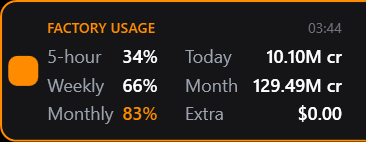

# Factory Usage Overlay

A small always-on-top drawer for Windows that shows your Factory usage: the 5-hour,
weekly and monthly limit percentages, plus today's and this month's credit spend.
It sits as a slim tab against the right edge of the screen, slides out when the mouse
reaches it, and tucks itself away again.



The badge on the left is a plain accent square. Drop a 256px `factory-logo.png` next
to `factory-usage.ps1` if you want your own icon there.

## What it shows

| Field | Where it comes from |
| --- | --- |
| 5-hour, Weekly, Monthly % | the progress bars on `app.factory.ai/settings/usage` |
| Extra | the extra-usage balance on the same page |
| Today, Month (credits) | `factoryCredits` in your own session files |

The stamp in the top-right is the time of the last successful reading. If a reading
fails, the last real numbers stay on the card with their age (`02:31 +12m`) until
they are an hour old, then the percentages fall back to `--` and the stamp says why
(`login once`, `close sign-in`, `limits slow`, `no limits`, `need node`,
`need chrome`).

## Requirements

- Windows 10 or 11 (WPF + Win32; not portable to Linux or macOS)
- PowerShell 5.1, which ships with Windows
- Node.js 22 or newer (the sampler uses the built-in global `WebSocket`)
- Google Chrome
- A Factory account

Node is looked up as `FACTORY_USAGE_NODE`, then `C:\Program Files\nodejs\node.exe`,
then `%LOCALAPPDATA%\Programs\nodejs\node.exe`, then `PATH`. Chrome is looked up as
`FACTORY_USAGE_CHROME`, then the per-user install, then `Program Files`, then `PATH`.

## Install

```powershell
git clone https://github.com/11456320/factory-usage-overlay.git
cd factory-usage-overlay

# start it now and at every sign-in, with no console window
powershell -ExecutionPolicy Bypass -File .\factory-usage.ps1 -Install

# one-time sign-in for the sampler's own Chrome profile
powershell -ExecutionPolicy Bypass -File .\factory-usage.ps1 -Login
```

`-Login` opens a normal Chrome window on the Factory usage page. Sign in, wait for
the numbers to appear, then close that window. It verifies with one silent sample
and fills the card immediately. You do not have to do this again unless the session
expires, at which point the stamp reads `login once`.

## Commands

```powershell
.\factory-usage.ps1 -Show                 # start (no-op if already running)
.\factory-usage.ps1 -Hide                 # stop
.\factory-usage.ps1 -Status               # pid, autostart, sampler, node, last sample
.\factory-usage.ps1 -Install              # start at sign-in, no console flash
.\factory-usage.ps1 -Uninstall            # remove autostart and stop
.\factory-usage.ps1 -Login                # one-time Factory sign-in
.\factory-usage.ps1 -IntervalSeconds 300  # re-sample period (60s floor)
.\factory-usage.ps1 -PeekSeconds 3        # stay open briefly on launch
```

`-Install` writes `factory-usage-launch.vbs` into your own Startup folder
(`%APPDATA%\Microsoft\Windows\Start Menu\Programs\Startup`). It needs no admin
rights and puts nothing on the desktop. `-Uninstall` deletes that file and stops the
overlay.

## How it works

Two independent sources, both local:

1. **Credits.** Every Factory session writes `*.settings.json` under
   `%USERPROFILE%\.factory\sessions`, containing `factoryCredits`. The overlay sums
   `today` and `this month` in the background.
2. **Limit percentages.** `factory-usage-limits.mjs` starts Chrome headless on its
   own profile at `%LOCALAPPDATA%\factory-usage-browser`, opens
   `app.factory.ai/settings/usage`, reads `aria-valuenow` off the rendered progress
   bars and the extra-usage balance out of the page text, then closes that Chrome.
   It takes about five seconds and shows nothing on screen.

No API is called and no credential file is read: this is an ordinary browser
loading the page you can already open while signed in, and reading what the page
renders. Nothing is sent anywhere.

Runtime state, none of it in the repo:

| Path | Contents |
| --- | --- |
| `%LOCALAPPDATA%\factory-usage-overlay.pid` | pid of the running overlay |
| `%LOCALAPPDATA%\factory-usage-overlay.pos.json` | dragged position |
| `%LOCALAPPDATA%\factory-usage-overlay.limits.json` | last good reading, so a restart starts populated |
| `%LOCALAPPDATA%\factory-usage-browser` | Chrome profile holding your Factory session cookie |

**The Chrome profile in that last row is a live session cookie.** Do not copy it,
commit it, or share the folder.

## Notes and limits

- The collapsed tab still covers the ~28px strip it sits on, because something
  grabbable has to receive mouse input. Drag it by the card to move it out of the way;
  the position is remembered.
- Credit totals are bucketed by each session file's last-write time, so a session
  that runs across midnight or a month boundary is counted whole against its last
  write.
- One sample costs a Chrome cold start, which is why the refresh period has a 60
  second floor and defaults to five minutes.
- The overlay is a `WS_EX_TOOLWINDOW` layered window: it stays out of Alt-Tab and
  never takes focus.

## Troubleshooting

| Stamp says | Meaning | Fix |
| --- | --- | --- |
| `login once` | the sampler's profile is signed out | run `-Login` again |
| `close sign-in` | a Chrome window still holds the sampler profile | close it |
| `limits slow` | the page did not finish in 45s | wait, it retries in a minute |
| `need node` | `node.exe` not found | install Node 22+, or set `FACTORY_USAGE_NODE` |
| `need chrome` | `chrome.exe` not found | install Chrome, or set `FACTORY_USAGE_CHROME` |
| `no limits` | page loaded but the numbers were not there | run `-Status`, then `-Login` |

`--` in the credits rows means no session files exist yet, so there is nothing to sum.

## License

MIT, see [LICENSE](LICENSE).

Not affiliated with or endorsed by Factory. The Factory logo is not included in this
repository; the app in the screenshot reads your own account's usage page.
